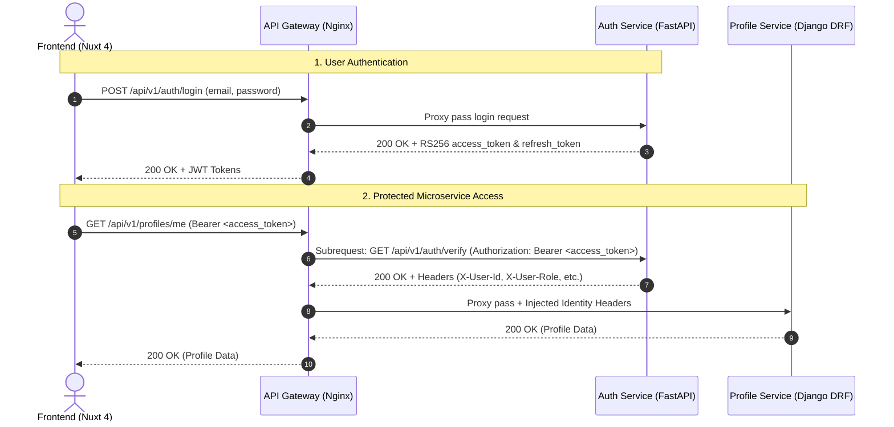

# Conecta Nexus - API Gateway

Reverse proxy and central API Gateway for the **Conecta Nexus** microservices ecosystem based on Nginx Alpine.

---

## Architecture & Responsibilities

The API Gateway acts as the single entry point for external traffic (Frontend Nuxt 4, mobile, third-party clients) and enforces platform-wide security policies:

- **Unified Routing (`/api/v1/*`)**: Proxies incoming traffic to appropriate downstream microservices.
- **RS256 JWT Authentication & Validation**:
  - Leverages Nginx `auth_request` pointing to the `@auth` microservice (`/api/v1/auth/verify`).
  - Statelessly verifies 2048-bit RS256 JWT signatures and token validity with sub-50ms latency (DoD auth / RF03).
  - Captures identity claims (`X-User-Id`, `X-User-Email`, `X-User-Role`, `X-User-Scopes`) via `auth_request_set` and injects them as trusted headers into downstream microservices.
- **Role-Based & Scope Separation**:
  - **Public Routes**: `/api/v1/auth/*` allows public registration, login, token refresh, password resets, and public key inspection without requiring an active token.
  - **Protected Routes**: `/api/v1/profiles/*`, `/api/v1/challenges/*`, `/api/v1/applications/*`, `/api/v1/moderation/*`, `/api/v1/notifications/*` require a cryptographically valid Bearer access token.
- **CORS Management**:
  - Preflight `OPTIONS` requests are intercepted at the gateway level and resolved with `204 No Content` and appropriate CORS headers.
  - Dynamic `Access-Control-Allow-Origin: $http_origin` with credential support (`Access-Control-Allow-Credentials: true`).
  - Exposes identity headers to the frontend.
- **Standardized JSON Error Responses**:
  - `401 Unauthorized`: Returns JSON payload with `WWW-Authenticate: Bearer` when token is missing, expired, or invalid.
  - `403 Forbidden`: Returns JSON payload for insufficient permissions.
  - `502 Bad Gateway` & `504 Gateway Timeout`: Clean JSON errors when downstream microservices are starting or unavailable.
- **Nuxt 4 / Vite WebSocket HMR Support**: Full support for `Upgrade` and `Connection: "upgrade"` headers on `/`.

---

## Route Mappings

| Prefix / Path | Access Policy | Target Upstream | Description |
| :--- | :--- | :--- | :--- |
| `/` | Public | `http://frontend:3000` | Nuxt 4 web application + Vite HMR WebSocket |
| `/gateway/health` | Public | *Nginx Local* | Gateway health check (`{"status":"healthy"}`) |
| `/api/v1/auth/` | Public | `http://auth:8000` | Register, login, refresh, password reset, certs, verify |
| `/api/v1/profile(s)?/` | **Protected (RS256 JWT)** | `http://profile:8000` | User profiles, academic records, Law 1581 consent |
| `/api/v1/challenge(s)?/` | **Protected (RS256 JWT)** | `http://challenge:8000` | Problem statement publishing & catalog |
| `/api/v1/application(s)?/` | **Protected (RS256 JWT)** | `http://application:8000` | Student applications & matching |
| `/api/v1/moderation(s)?/` | **Protected (RS256 JWT)** | `http://moderation:8000` | Administrative moderation & audit logs |
| `/api/v1/notification(s)?/` | **Protected (RS256 JWT)** | `http://notification:8000` | User notifications & alerts |
| `/services/<service>/` | Direct Probe | `http://<service>:8000/` | Inspect microservice root or `/health` directly |

---

## Authentication Flow



---

## Local Execution & Verification

### Running via Compose (Recommended)
```bash
# Start all microservices and the gateway:
podman compose up --build gateway

# Test Gateway health:
curl -i http://localhost:8080/gateway/health

# Test unauthenticated access to a protected route (Expect 401 JSON):
curl -i http://localhost:8080/api/v1/profiles/me

# Test public login via Gateway:
curl -i -X POST http://localhost:8080/api/v1/auth/login \
  -H "Content-Type: application/json" \
  -d '{"email":"student@ufps.edu.co","password":"Password123!"}'
```

### Building the Standalone Docker Image
```bash
cd gateway
podman build -t conecta-nexus-gateway .
```
